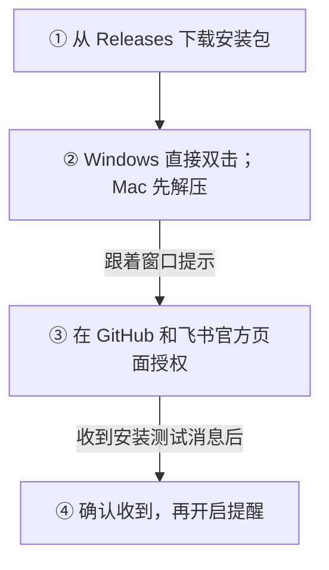

# Codex 提前重置提醒

**Codex 额度可能提前重置，或第三方记录到公共重置事件时，给你发一条飞书提醒。**

预测来自第三方，**不是 OpenAI 的保证**。收到提醒，也不代表你的额度已经恢复。预测也包含备用重置额度的发放，仍需你去 Codex 查看。

[开始](#start) · [使用](#use) · [求助](#help)

## 这是什么

像一个“小闹钟”：帮你留意 Codex 有没有可能提前恢复额度。

- 每小时看一次[第三方预测](https://codex.gussuriworks.com/api/current)。
- 数据正常、够新，且未来 24 小时的概率**超过 80%**，发送预测提醒。
- 第三方新增确认的公共重置记录时，另发一条事件提醒，不受预测概率影响。
- 两类提醒分别去重；升级后的首次检查只记录已有历史，不补发旧事件。

通过窗口安装器设置后，提醒发给你自己的飞书账号。它不会帮你重置额度，也不需要你提供 OpenAI 密码。

## 怎么下载／开始

选择适合自己电脑的测试版：

| 你的电脑 | 下载 |
|---|---|
| Mac（Apple 芯片） | [Mac 测试版 ZIP](https://github.com/YuShenLiu06/codex-reset-monitor/releases/download/v0.1.6-preview.1/codex-reset-installer-macos-arm64-preview.zip) |
| Windows（64 位） | [Windows 单 EXE 测试版](https://github.com/YuShenLiu06/codex-reset-monitor/releases/download/v0.1.6-preview.1/codex-reset-installer-windows-x64-preview.exe) |

不用额外安装工具，也不用自己创建连接应用。可以邀请他人试用并反馈，完整真实账号流程仍在验证。系统可能阻止打开，遇到拦截请暂停，保留系统安全保护。版本变化见[发布页](https://github.com/YuShenLiu06/codex-reset-monitor/releases/tag/v0.1.6-preview.1)。

Mac 完整解压后双击「Codex 提醒设置」；Windows 直接双击下载的 EXE，等待本地组件准备完成。GitHub 的「Download ZIP」是源码，不是安装包。

开始方式：

测试时按[本人验收清单](docs/user-acceptance.md)核对；Windows 也可看[三步开始](docs/windows-preview.md)。这是测试版，不要当正式版转发。

## 怎么用

安装并确认开启后，提醒任务会在 GitHub 上定时运行。你平时看飞书消息就好。

| 看到什么 | 你要做什么 |
|---|---|
| “安装测试”消息 | 核对窗口中的标识；它只是测试，不是重置预告。 |
| 概率提醒 | 把它当参考，去 Codex 查看自己的实际额度。 |
| “数据源记录到公共重置事件” | 第三方的新记录，不代表本人账户额度已恢复；去 Codex 查看。 |
| 一直没有消息 | 可能没达到提醒条件；也可能任务停了，去你自己的仓库 Actions 页面看最近运行。 |

定时任务可能延迟或漏跑。建议每月检查一次 Actions，确认它还在运行。

想停止提醒：在你自己的仓库 **Actions → Hourly monitor → ⋯ → Disable workflow** 停用工作流。已经开始的任务需另行取消。熟悉终端的用户也可看[关闭与恢复说明](docs/operations.md)。

## 卡住怎么办

| 问题 | 下一步 |
|---|---|
| 下载后找不到程序 | Windows 双击上方 EXE；Mac 完整解压对应 ZIP；不要把源码 ZIP 当安装包。 |
| 系统拦住测试包 | 暂停并反馈系统提示，保留安全保护。 |
| 窗口要求填应用编号或地址 | 可能用了旧包或自行构建的包；先核对下载版本，不要反复创建应用。 |
| 授权或权限检查没通过 | 按窗口提示核对目标账号、仓库和权限；详细见[验收与恢复](docs/user-acceptance.md#失败恢复)。 |
| 测试消息没收到／结果不明 | 先停下，核对飞书和 Actions 记录，不要反复点击发送。 |

反馈时只提供失败阶段、错误码和脱敏后的说明。**不要发送密码、密钥、授权码或完整账号截图。** 可在 [Issues](https://github.com/YuShenLiu06/codex-reset-monitor/issues)反馈。

维护者与高级用户文档

- [GitHub App 注册与权限](docs/github-app-maintainer.md)
- [用 Actions 构建与发布](docs/releasing.md)
- [macOS 构建方案与当前测试状态](docs/macos-installer-plan.md)
- [安装器授权、安全与打包审查](docs/installer-review.md)
- [手动部署、去重机制与故障恢复](docs/operations.md)
- [本人验收清单](docs/user-acceptance.md)

